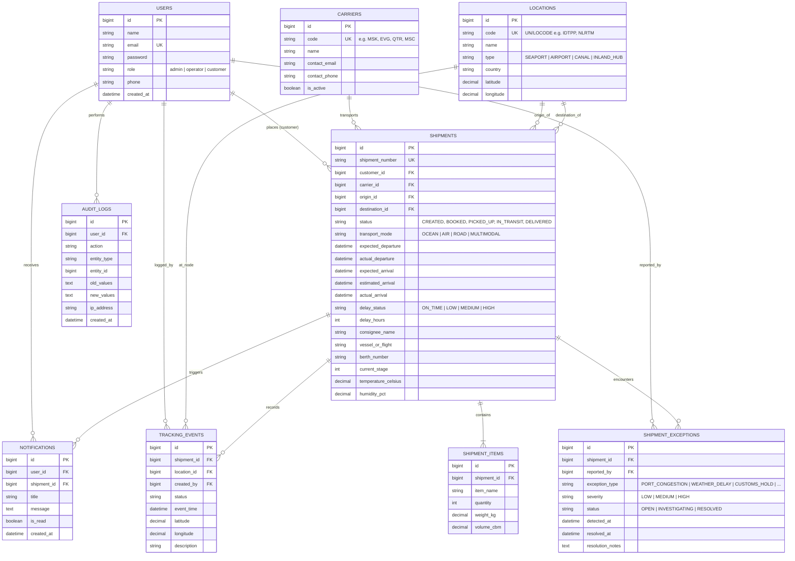

# CargoTrace • Vector Global Shipment Visibility & Tracking Platform

[](https://laravel.com)
[](https://php.net)
[](https://mysql.com)
[](https://leafletjs.com)
[](https://tailwindcss.com)
[-brightgreen?style=for-the-badge&logo=php)](https://phpunit.de)

> **UAS Web Programming 2 — Final Engineering Portfolio Project**  
> **Brand**: Vector CargoTrace (*"Trace the Line"*)  
> **Architecture**: Service-Oriented Laravel Clean Architecture with Multi-Role RBAC, Leaflet GIS Radar, Live Weather Integration, and REST API.

---

## 📌 Executive Summary

### Problem
In international shipping and supply chain logistics, consignment information is heavily fragmented across ocean liners, air cargo carriers, terminal operators, and customs authorities. Cargo owners and logistics coordinators frequently face:
1. **Lack of Real-Time Corridor Visibility**: Unclear voyage milestones and missing geo-coordinates.
2. **Hidden Delays & Bottlenecks**: Maritime congestion (e.g., Suez Canal queues) and customs delays are not detected deterministically.
3. **Decentralized Exception Logging**: Incident resolutions (such as reefer temperature deviations or documentation mismatches) are uncoordinated.

### Solution: CargoTrace
CargoTrace provides an enterprise-grade visibility and telemetry hub:
- **Interactive Live GIS Radar Map (Leaflet.js + OpenStreetMap)**: Real-time visual tracking of maritime routes and air freight corridors with animated markers and port berthing countdowns.
- **Deterministic ETA & Delay Engine**: Multi-tier delay calculation (`LOW` 0–6h, `MEDIUM` 6–24h, `HIGH` >24h) tied to strict terminal status immutability.
- **Incident Desk**: Complete lifecycle management for operational exceptions (`OPEN` &rarr; `INVESTIGATING` &rarr; `RESOLVED`).
- **External Meteorological Telemetry**: Live maritime weather integration powered by the Open-Meteo API.
- **Comprehensive REST API**: Full Sanctum-authenticated JSON API contract with Postman collection provided.

---

## 🏗️ System Architecture

CargoTrace strictly decouples HTTP transport logic from core business domain rules via a **Service Layer Architecture**:

```
[ Browser / Client / Mobile App ]
              │
              ▼
   [ Routes & Middleware ]
   (auth, role:admin,operator,customer, Sanctum)
              │
              ▼
      [ Controllers ]
   (Web & Api Resource Controllers)
              │
              ▼
     [ Service Layer ]
  ├── ShipmentService        ── Consignment queries, KPIs & manifests
  ├── TrackingService        ── Chronological events & status transitions
  ├── EtaService             ── Deterministic delay math & thresholds
  ├── ExceptionService       ── Incident detection & resolution notes
  ├── ExternalWeatherService ── Real-time Open-Meteo weather telemetry
  └── AuditService           ── Security audit trail logging
              │
              ▼
     [ Eloquent Models ]
   (User, Carrier, Location, Shipment, TrackingEvent, Exception, Notification, AuditLog)
              │
              ▼
    [ MySQL 8.x Database ]  &  [ External APIs ]
```

---

## 📊 Entity Relationship Diagram (ERD) & Data Model

The database schema implements 8 relational models with foreign key constraints, indexes, and cascade protections:



---

## ⚙️ Core Business Rules

### 1. Shipment Status Lifecycle & Terminal State Immutability
Transitions follow a strict state machine:
- `CREATED` &rarr; `BOOKED` &rarr; `PICKED_UP` &rarr; `IN_TRANSIT` (or `IN_FLIGHT`, `BERTHED`) &rarr; `DELIVERED`
- **Terminal State Protection**: Once a consignment reaches `DELIVERED` or `CANCELLED`, it cannot be regressed or modified without administrative override.

### 2. Deterministic ETA & Delay Calculation Rule
Whenever `estimated_arrival` is updated, the delay engine computes:
$$\Delta t = \text{estimated\_arrival} - \text{expected\_arrival}$$
- If $\Delta t \le 0$: `delay_hours = 0`, `delay_status = 'ON_TIME'`
- If $0 < \Delta t \le 6 \text{ hours}$: `delay_status = 'LOW'`
- If $6 < \Delta t \le 24 \text{ hours}$: `delay_status = 'MEDIUM'`
- If $\Delta t > 24 \text{ hours}$: `delay_status = 'HIGH'`

### 3. Role-Based Access Control (RBAC)
- **Administrator (`admin`)**: Complete system access (manage users, carriers, locations, all shipments, view audit trails, delete resources).
- **Logistics Operator (`operator`)**: Dispatch shipments, append chronological tracking events, report and resolve exceptions on the Incident Desk.
- **Customer (`customer`)**: Strictly scoped to view only their assigned consignments, tracking timelines, and relevant notifications.

---

## 🎨 UI/UX Design System

CargoTrace adheres to the modern Vector identity inspired by high-tech dark radar displays:
- **Brand Identity**: Vector origami emblem with forest/emerald green theme (`#1E5A3F`, `#166534`, `#10B981`, `#22C55E`).
- **GIS AIS & ADS-B Radar**: Interactive dark-matter tiles (CartoDB/OpenStreetMap) plotting ocean trajectories (Jakarta &rarr; Suez &rarr; Rotterdam) and air corridors (Singapore &rarr; Frankfurt) with live waypoints.
- **Voyage Milestones Bar**: Visual multi-stage progress (Stage 1 Tanjung Priok &rarr; Stage 2 Singapore &rarr; Stage 3 Suez Canal Waiting Area &rarr; Stage 4 Rotterdam).
- **Sensor Telemetry Cards**: Real-time cold chain temperature & humidity monitors (4.2°C, 62%) and ADS-B flight telemetry (Airspeed 485 Kts, FL360).
- **Dual-Pane Modern Auth View**: High-resolution ambient gradient card with 1-click evaluation demo switchers.

---

## 🔑 Demo Accounts

Use these pre-seeded accounts to evaluate different permission levels:

| Role | Email | Password | Access Scope |
| :--- | :--- | :--- | :--- |
| **Administrator** | `admin@cargotrace.com` | `password` | Full system control, audit logs, carriers & hubs |
| **Logistics Operator** | `operator@cargotrace.com` | `password` | Tracking events, status transitions, incident desk |
| **Customer 1** | `customer@cargotrace.com` | `password` | PT Samudera Logistik Mitra (AT-2026-B8910, AWB-772-91024) |
| **Customer 2** | `transasia@cargotrace.com` | `password` | Trans-Asia Freight Corp (AT-2026-90412) |

> 💡 **Tip**: On the login page, you can click any of the **1-Click Demo Evaluation Roles** buttons to instantly sign in without typing!

---

## 📡 REST API Specification

All API endpoints return standard JSON responses:

```json
{
    "success": true,
    "message": "Operation successful.",
    "data": { ... }
}
```

### Endpoints Overview

| Method | Endpoint | Description | Auth Required |
| :--- | :--- | :--- | :--- |
| `POST` | `/api/register` | Register a new user and receive Bearer Token | No |
| `POST` | `/api/login` | Authenticate and obtain Sanctum Bearer Token | No |
| `GET` | `/api/user` | Get authenticated user profile | Bearer Token |
| `POST` | `/api/logout` | Revoke active API token | Bearer Token |
| `GET` | `/api/shipments` | List consignments with filters & pagination | Bearer Token |
| `POST` | `/api/shipments` | Create consignment with cargo items | Operator / Admin |
| `GET` | `/api/shipments/{id}` | Get full shipment manifest & history | Bearer Token |
| `PUT/PATCH` | `/api/shipments/{id}` | Update shipment schedule or details | Operator / Admin |
| `DELETE` | `/api/shipments/{id}` | Delete consignment manifest | Admin only |
| `GET` | `/api/shipments/{id}/tracking` | Get chronological tracking events | Bearer Token |
| `POST` | `/api/shipments/{id}/tracking` | Record tracking event & update status | Operator / Admin |
| `GET` | `/api/carriers` | List all active shipping carriers | Bearer Token |
| `POST` | `/api/carriers` | Register a new partner carrier | Operator / Admin |
| `GET` | `/api/locations` | List global port & airport nodes | Bearer Token |
| `POST` | `/api/locations` | Add a new strategic hub node | Operator / Admin |
| `GET` | `/api/shipments/{id}/exceptions` | List exceptions on a shipment | Bearer Token |
| `POST` | `/api/shipments/{id}/exceptions` | Report an operational incident | Operator / Admin |
| `PATCH` | `/api/exceptions/{id}` | Resolve or investigate an incident | Operator / Admin |

> 📁 **Postman Collection**: Import the file `CargoTrace_Postman_Collection.json` directly into Postman to test all endpoints.

---

## 🚀 Installation & Local Setup

### Prerequisites
- **PHP**: 8.2 or 8.3+ with `pdo_mysql`, `curl`, `mbstring`, `openssl`
- **Composer**: 2.x
- **Node.js**: 18+ & **npm**
- **MySQL**: 8.x (or XAMPP / MariaDB)

### Setup Steps

1. **Clone the repository**:
   ```bash
   git clone https://github.com/your-username/cargotrace-vector.git
   cd cargotrace-vector
   ```

2. **Install PHP Dependencies**:
   ```bash
   composer install
   ```

3. **Install & Build Frontend Assets**:
   ```bash
   npm install
   npm run build
   ```

4. **Environment Configuration**:
   ```bash
   cp .env.example .env
   php artisan key:generate
   ```
   Ensure `.env` matches your MySQL setup:
   ```env
   DB_CONNECTION=mysql
   DB_HOST=127.0.0.1
   DB_PORT=3306
   DB_DATABASE=cargotrace
   DB_USERNAME=root
   DB_PASSWORD=
   ```

5. **Run Migrations & Seeders**:
   ```bash
   php artisan migrate:fresh --seed
   ```

6. **Start Local Development Server**:
   ```bash
   php artisan serve
   ```
   Open your browser at `http://127.0.0.1:8000`.

---

## 🧪 Automated Testing

CargoTrace includes a comprehensive automated test suite (22 unit & feature tests, 60 assertions) testing authorization, CRUD operations, lifecycle state machines, deterministic delay rules, and exception workflows.

Run tests using PHPUnit / Artisan:
```bash
php artisan test
```

### Test Coverage Highlights:
- `Tests\Feature\AuthTest`: Login validation, password failures, guest redirection, Sanctum token generation.
- `Tests\Feature\ShipmentTest`: Scoped customer queries, authorization gates, origin-destination uniqueness.
- `Tests\Feature\TrackingAndLifecycleTest`: Sequential status transitions, rejection of illegal reversions from terminal state (`DELIVERED`).
- `Tests\Feature\EtaDelayRuleTest`: Mathematical validation of `ON_TIME`, `LOW`, `MEDIUM`, and `HIGH` delay thresholds.
- `Tests\Feature\ExceptionManagementTest`: Incident reporting, delay impact propagation, resolution notes audit.

---

## 🌐 External API Integrations

1. **Open-Meteo Weather API**:
   - `GET https://api.open-meteo.com/v1/forecast`
   - Real-time temperature, humidity, wind velocity, and maritime condition codes.
   - Built with timeout handling (`timeout(3)`), error recovery, and 15-minute caching fallback.
2. **OpenStreetMap & CartoDB Dark Matter**:
   - High-contrast GIS nautical radar tiles rendered through Leaflet.js with SVG vessel & aircraft icons.

---

## 📚 Attributions & Licenses
- **Framework**: [Laravel 12](https://laravel.com)
- **Map Engine**: [Leaflet.js](https://leafletjs.com) & [CartoDB](https://carto.com)
- **Weather Telemetry**: [Open-Meteo](https://open-meteo.com)
- **Icons & Styling**: [Tailwind CSS](https://tailwindcss.com) & SVG Vector Logistics Icons

---
*Built with ❤️ for Web Programming 2 UAS by a Senior Software Engineer.*
